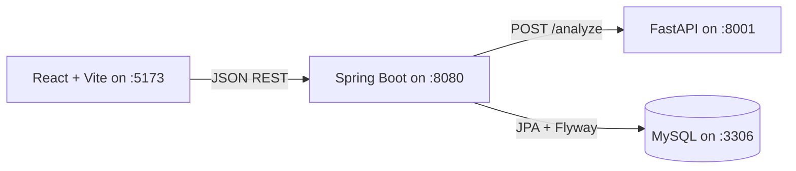

# ScamShield AI

ScamShield AI is a student portfolio project that screens job posts, internship listings, and recruiter messages for contextual warning signals. It returns a bounded risk estimate, explains the configured signals it found, and suggests independent verification steps.

> **Important:** ScamShield is a screening aid, not a fraud determination. It does not verify employers, recruiters, websites, email domains, or job listings. A low score is not proof of legitimacy, and a high score is not proof of fraud.

## Features

- Responsive React dashboard, landing page, job analyzer, scan history, and methodology page.
- Python FastAPI analysis service with an explainable rule-based baseline; no fabricated training corpus or accuracy claims.
- Optional TF-IDF + logistic-regression training workflow for a real, licensed, documented dataset.
- Spring Boot REST API, MySQL persistence, Flyway migration, paging, history deletion, statistics, and 14-day trends.
- Scan text is stored only when the user selects **Save to history**; no account or authentication is implemented in this portfolio version.
- Explicit error states when the API, analysis service, or database is unavailable.

## Architecture



The browser talks only to Spring Boot. Spring Boot calls FastAPI and stores saved scans in MySQL. Analysis requests do not persist text; saving triggers a new analysis and stores that result.

## Technology

- Frontend: React 18, Vite, React Router, Recharts, Lucide, CSS, Vitest and Testing Library.
- API: Java 17+ / Java 21-compatible Spring Boot 3.5, Spring Web, Bean Validation, Spring Data JPA, Flyway and Maven.
- Analysis: Python 3.11+, FastAPI, pandas, scikit-learn, TF-IDF, logistic regression and pytest.
- Database: MySQL 8.4.

## Project structure

```text
frontend/       React UI, API client, styles, and frontend tests
backend/        Spring Boot API, Flyway migration, and backend tests
ml-service/     FastAPI service, rule scoring, model training, and tests
database/       MySQL bootstrap SQL
docs/           Scoring, privacy, and deployment notes
docker-compose.yml  Local MySQL container
```

## Prerequisites

- Node.js 20.19+ or 22.12+ and npm (required by Vite 7).
- Python 3.11+ and pip (Python 3.14 was available during initial project setup; use a supported scikit-learn/pandas wheel for your Python version).
- Java 17 or newer (Java 21 is supported).
- Docker Desktop for the local MySQL option, or a separately installed MySQL 8.4 server.
- Internet access for the first dependency install.

Maven is not required globally: `backend\mvnw.cmd` downloads a pinned Maven distribution into the current Windows user's Maven cache on first use. If you already have Maven installed, `mvn` works instead.

## Local setup (Windows PowerShell / VS Code)

Open the project folder in VS Code. Use one terminal per service. The database and backend require the same local development credentials; change them for any non-local environment.

### 1. Start MySQL

From the project root:

```powershell
Copy-Item .env.example .env
# Keep the example values only for local development; use your own private values otherwise.
docker compose up -d mysql
docker compose ps
```

The Compose file reads `.env`. The initial migration creates the scan table when the backend starts. To stop MySQL, run `docker compose down`; the named volume preserves saved records. To remove the database volume and all local records, run `docker compose down -v`.

If you already run MySQL locally, create a database named `scamshield`, provide the credentials as environment variables in the backend terminal, and skip Docker.

### 2. Start the Python analysis service

In a second terminal:

```powershell
Set-Location .\ml-service
python -m venv .venv
.\.venv\Scripts\Activate.ps1
python -m pip install -r requirements.txt
uvicorn app.main:app --reload --host 127.0.0.1 --port 8001
```

Check `http://127.0.0.1:8001/health` or interactive API docs at `http://127.0.0.1:8001/docs`. Without a trained model file, the service reports and uses `rules-baseline-v1`; this is intentional and not a simulated ML prediction.

### 3. Start Spring Boot and MySQL integration

In a third terminal, from the project root:

```powershell
$env:MYSQL_HOST = "localhost"
$env:MYSQL_PORT = "3306"
$env:MYSQL_DATABASE = "scamshield"
$env:MYSQL_USER = "scamshield"
$env:MYSQL_PASSWORD = "scamshield_dev"
$env:ML_SERVICE_URL = "http://localhost:8001"
$env:FRONTEND_ORIGIN = "http://localhost:5173"
Set-Location .\backend
..\mvnw.cmd spring-boot:run
```

The API health check is `http://localhost:8080/api/health`. The database schema is migrated by Flyway at startup; Hibernate validates it. `JPA_DDL_AUTO=validate` is the default.

### 4. Start the frontend

In a fourth terminal:

```powershell
Set-Location .\frontend
npm install
Copy-Item .env.example .env
npm run dev
```

Open the Vite URL shown in the terminal (normally `http://localhost:5173`). The API base URL defaults to `http://localhost:8080/api`; set `VITE_API_BASE_URL` in `frontend/.env` when it differs.

### Port conflicts

Default ports are Vite `5173`, Spring Boot `8080`, FastAPI `8001`, and MySQL `3306`. To inspect a port on Windows, use `Get-NetTCPConnection -LocalPort 8080 -State Listen` (replace the port as needed). Configure Vite with `npm run dev -- --port 5174`, Spring Boot with `SERVER_PORT`, FastAPI with its `--port` argument, or MySQL with `MYSQL_PORT` in `.env`. Update the corresponding API URL/CORS variables when changing ports.

## Risk scoring and ML status

The exact rules, weights, duplicate handling, and thresholds are documented in [docs/scoring.md](docs/scoring.md) and implemented in `ml-service/app/scoring.py`. A score is a rules-weight summary, not a probability. Neutral job terms such as “remote,” “urgent,” and “salary” do not independently produce a warning. Distinct detected signals add once each; scores are capped at 100.

No training data is bundled, downloaded, or treated as evidence. If you supply an appropriately licensed and documented dataset, the optional training script fits TF-IDF on the training split only, evaluates once on a stratified hold-out split, reports precision/recall/F1 and a confusion matrix, and saves a model artifact locally (ignored by Git).

Example CSV format:

```csv
text,label
"Full job posting text from a dataset you are permitted to use",legitimate
"Full job posting text from a dataset you are permitted to use",scam
```

Document the dataset source, exact license, collection date, preprocessing, and permitted use before training. Then run from `ml-service`:

```powershell
python train.py --dataset .\data\documented-dataset.csv --text-column text --label-column label
```

Supported labels are `scam` / `fraud` / `fraudulent` / `fake` / `1` and `legitimate` / `real` / `genuine` / `not scam` / `not fraud` / `0`. The data is split before vectorizer fitting to avoid text-feature leakage. Test-set metrics describe only that dataset and are not production accuracy or calibrated probabilities. Restart FastAPI after training to load `models/job-scam-model.joblib`. See [docs/scoring.md](docs/scoring.md) for scoring and model combination details.

## API

All browser-facing routes are under `/api`. FastAPI routes are called by Spring Boot and are not intended to be exposed to the browser.

| Method | Path | Purpose |
|---|---|---|
| GET | `/api/health` | Backend health |
| POST | `/api/scans/analyze` | Analyze without persisting text |
| POST | `/api/scans` | Analyze and save a scan (`201 Created`) |
| GET | `/api/scans?page=0&size=10&riskLevel=High&search=intern` | Search and page saved scans |
| GET | `/api/scans/{id}` | Read a saved scan, including its stored text |
| DELETE | `/api/scans/{id}` | Permanently delete a saved scan |
| GET | `/api/dashboard/stats` | Actual totals, risk counts, and recent records |
| GET | `/api/dashboard/trends` | Actual saved scan counts for the last 14 UTC dates |
| GET | `http://localhost:8001/health` | Analysis service health |
| POST | `http://localhost:8001/analyze` | Internal text analysis |

Example:

```powershell
$body = @{ text = "Paste at least 30 characters of opportunity text here." } | ConvertTo-Json
Invoke-RestMethod -Method Post -Uri http://localhost:8080/api/scans/analyze -ContentType "application/json" -Body $body
```

Input length is restricted to 30–20,000 characters. Scan listing responses include a short preview and omit full text; the detail endpoint returns text so the owner of this single-user local instance can review or delete it.

## Tests and builds

Run from each folder:

```powershell
# Frontend
Set-Location .\frontend
npm install
npm test
npm run build

# Python (activate the ml-service virtual environment first)
Set-Location ..\ml-service
pytest

# Spring Boot (requires Java 17+, Maven wrapper downloads Maven)
Set-Location ..\backend
..\mvnw.cmd test
..\mvnw.cmd package
```

Backend controller tests use mocks and do not need a running MySQL instance. End-to-end persistence checks require MySQL, FastAPI, and Spring Boot to be running.

## Privacy and security

- Do not paste passwords, banking data, identity numbers, private recruiter details, or other sensitive personal information.
- Unsaved analysis text is sent to the backend and analysis service for processing but is not stored by the application. Saving stores the full submitted text, score, explanations, and timestamp in MySQL.
- Delete a saved scan in the history page to remove it from the application database. Backups/managed database retention may have separate policies.
- This first portfolio version has no login, user isolation, rate limiting, or account system. The scan API and history are therefore **not appropriate for public production deployment as-is**. Add authentication/authorization, abuse controls, TLS, secret management, and a retention policy before exposing a deployed backend to untrusted users.
- Frontend code contains no database credential. Backend DB and ML URLs are configured server-side.
- Pasted text is not executed or rendered as HTML.

See [docs/privacy.md](docs/privacy.md) for storage details and [docs/deployment.md](docs/deployment.md) for deployment guidance and limitations.

## Deployment

- **Frontend:** deploy `frontend/` to Vercel. Set `VITE_API_BASE_URL` to the deployed API's HTTPS URL ending in `/api`; `vercel.json` rewrites SPA routes.
- **Spring Boot:** build `backend/` with `..\mvnw.cmd package`, or deploy the included `backend/Dockerfile`. Configure `SPRING_DATASOURCE_URL`, `MYSQL_USER`, `MYSQL_PASSWORD`, `ML_SERVICE_URL`, `FRONTEND_ORIGIN`, and `JPA_DDL_AUTO=validate` as private service variables.
- **FastAPI:** deploy `ml-service/` or its `Dockerfile` to a Python-compatible host. Use `uvicorn app.main:app --host 0.0.0.0 --port $PORT` (adapt the shell syntax to the host), configure a reachable internal `ML_SERVICE_URL`, and mount/provide the optional model artifact if using a trained model.
- **Database:** use a managed MySQL 8 service, private networking where available, TLS, least-privilege credentials, backups, and appropriate retention.

Deployment templates are not a completed deployment. No external hosting, public URL, production data source, or credentials have been provisioned or verified. **Do not expose the unauthenticated history API publicly.** More details: [docs/deployment.md](docs/deployment.md).

## Screenshots

Add screenshots of your locally running app here after reviewing the results on your own data. The landing-page preview is explicitly demonstration-only; no dashboard counts or analysis results are fabricated.

## Limitations and future work

- Rules are a conservative baseline, not an independently evaluated fraud classifier.
- The optional model is not bundled; model output is mixed with rule score at 30% / 70% and is not calibrated as a fraud probability.
- Indicators can have false positives and false negatives; the app performs no employer, domain, or identity verification.
- History is single-user and has no authentication. Public deployment requires identity and authorization work first.
- Future work: user accounts, access control, configurable deletion/retention, validated and licensed training data, model calibration and external evaluation, and opt-in verified employer signals.

## License and data attribution

No third-party dataset or trained model is included. Before choosing a project license or using a training dataset, check its upstream license, attribution, privacy, and redistribution terms. Record the chosen project license and dataset provenance before publishing or training.
